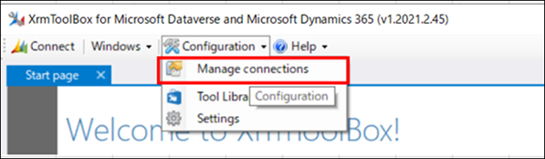
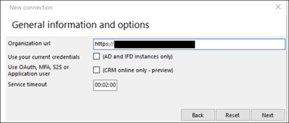
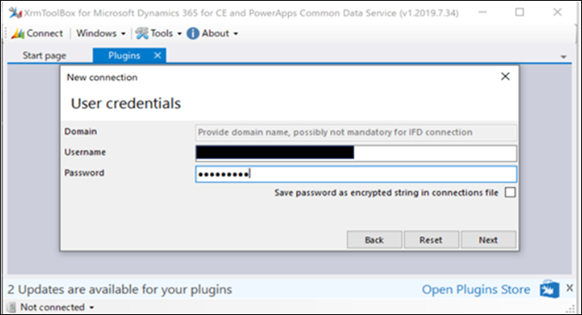
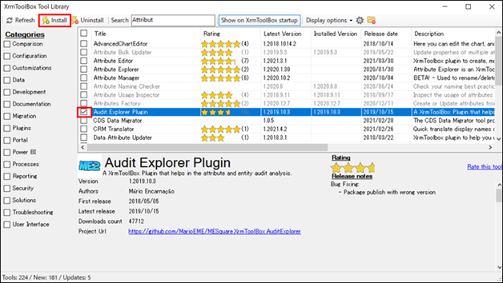
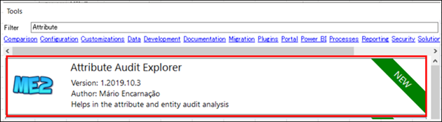
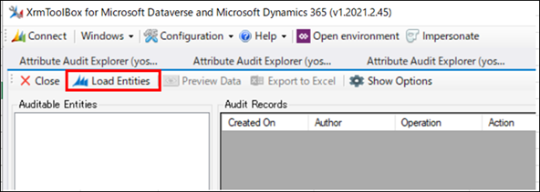
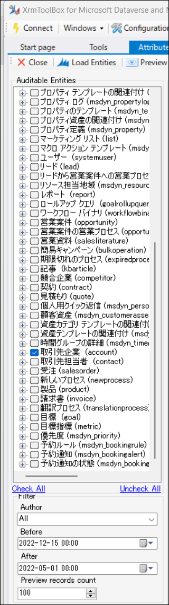
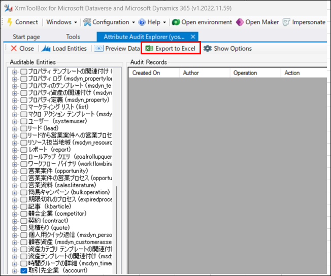
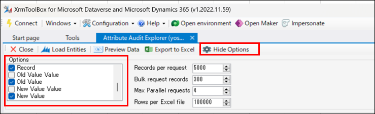
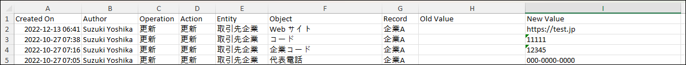

#  Dataverse の監査ログをエクスポートする方法

こんにちは、Power Platform サポートチームの鈴木です。  

Dataverse の監査ログは、レコードに対する変更履歴を監査概要ビューで表示できます。  
Dataverse の監査ログの取得や、確認方法については下記公開情報をご参照ください。  
(ご参考 : [Dataverse 監査を管理する](https://learn.microsoft.com/ja-jp/power-platform/admin/manage-dataverse-auditing))  

サポートチームでは、監査概要ビューの内容をエクスポートしたい、というお問い合わせをいただくことがありますが、2023 年 4 月現在では、Dataverse 監査ログのエクスポート機能を提供していません。
そこで、今回は XRMToolBox というサードパーティ製のツールを使用したエクスポート方法をご紹介します。  
XRMToolBox は当社提供のツールではないため、詳細な使用方法やエラーへの対処は提供元へご確認ください。あらかじめご了承のうえ、ご利用ください。  

<!-- more -->

## 事前準備  
---
XRMToolBox とは、Dataverse に接続し、操作できる Windows アプリケーションとなります。  
事前にインストールし、接続設定を行うことで、Web API でしか実行できないような Dataverse 環境に対する様々なアクションを GUI 操作によって可能にします。  

1. XRMToolBox を以下のサイトよりダウンロードします。  
    [XRMToolBox 公式サイト](https://www.xrmtoolbox.com/)

2. XRMToolBox アプリケーションを開きます。  

3. Configuration タブより Manage connections を選択します。  
    

4. New Connection > Connection Wizard を選択します。  

5. Organization url に対象の Dataverse 環境の URL を入力し、Next を選択します。  
    

6. 環境にサインイン可能な Username と Password を入力し、Next を選択します。  
    

7. Connection に任意の名前を入力し、Finish を選択します。  

8. Connection が作成されたことを確認し、Connections Manager ウィンドウを閉じます。  

これで、XRMToolBox のインストールと Dataverse 環境への接続が完了です。  

## ツールのインストール
---
XRMToolBox には、様々なツールが存在しますが、今回は監査ログをエクスポートするための、Attribute Audit Explorer というツールを使用します。  
Attribute Audit Explorer の詳細については、下記をご参照ください。  
(ご参考 : [Audit Explorer Plugin](https://www.xrmtoolbox.com/plugins/MESquare.XrmToolBox.AuditExplorer/))  

1. Configuration > Tool Library を開き、Audit Explorer Plugin にチェックし Install を選択します。  
    

2. Tool Library ウィンドウを閉じます。  

## Audit Explorer Plugin を使用して、Dataverse の監査ログをエクスポートする  
---
1. Tools ウィンドウで Attribute Audit Explorer をダブルクリックで開きます。  
    

2. 「Do you want to connect to an organization first?」というダイアログが表示された場合は「はい」を選択し、作成した Connection 先を選び Connect を選択してください。  

3. Load Entities を選択します。  
   

4. 監査が有効化されているテーブルが表示されますので、ログを取得したいテーブルと取得する監査ログの日時を選択します。  
    ※Before が取得終了日、After が取得開始日になりますので、ご注意ください。  
   

5. Export to Excel を選択すると、監査ログが CSV ファイル形式で出力されます。  
   

なお、出力する列は、オプションで選択できます。  
   

## エクスポートした監査ログの確認
---
エクスポートした csv ファイルでは、各列の値を一覧で確認できます。  
   

## おわりに
---
Microsoft 365 のコンプライアンスセンターから Dataverse に関する監査ログを確認し、エクスポートする方法もあります。  
しかし現時点では、Dataverse 環境に関しては監査概要ビューから確認することで、レコードに対する変更履歴が分かりやすく表示されるため、ご利用いただいているユーザー様も多数いらっしゃるかと思います。  
監査概要ビューでは提供していないエクスポート機能が、XRMToolBox を利用することで可能となりますので、ぜひご活用いただけますと幸いです。  
