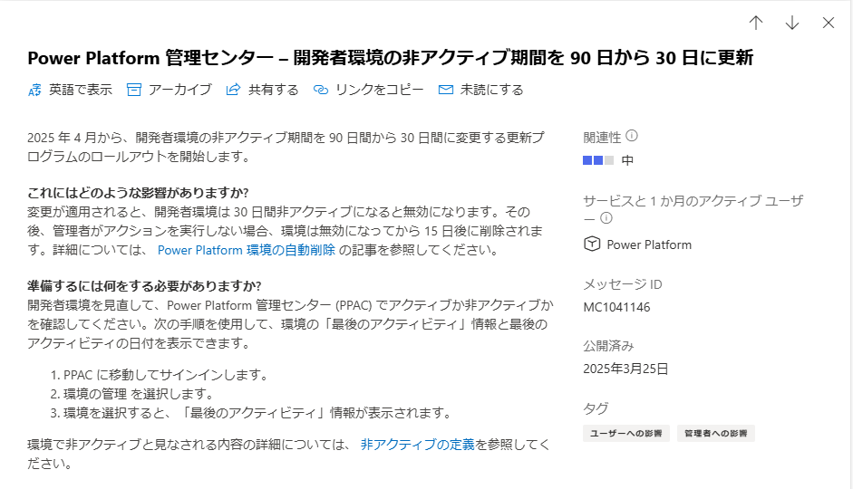
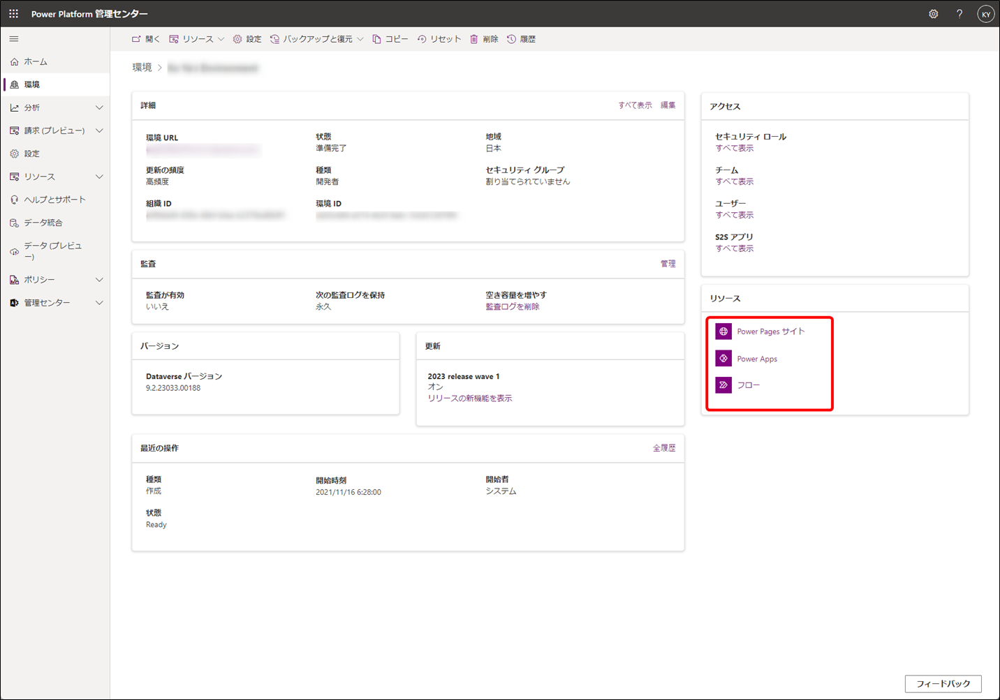

こんにちは、Power Platform サポートの山田です。 
今回は、Power Platform の開発者環境の自動削除について、下記項目の順にご説明いたします。  

1. 開発者環境の自動無効化/削除メカニズムとは  
2. 自動無効化/削除条件  
3. 自動無効化/削除メカニズム自体の無効化の可否  
4. 無効化/削除された環境の復元
5. 環境の状態遷移
6. ご案内メール  
7. ご案内メールを受信された際の対応   
8. よくあるご質問  

下記公開情報を基にご説明いたします。   
[Automatic deletion of Power Platform environments (英語)](https://learn.microsoft.com/en-us/power-platform/admin/automatic-environment-cleanup)   
[Power Platform 環境の自動削除 (上記の日本語訳)](https://learn.microsoft.com/ja-jp/power-platform/admin/automatic-environment-cleanup)   
各項目について公開情報内にも詳細を記載していますのでご参照ください。 
なお、英語のページが更新されてから、日本語訳のページに同様の内容が反映されるまでに時間がかかる場合があります。 
そのため、最新情報については英語版も併せてご確認ください。
 
 
<!-- more -->  

## 1. 開発者環境の自動無効化/削除メカニズムとは
本メカニズムによって、ユーザーによる活動のない期間 (=非アクティブ期間) が 30 日間 (※) 続いた場合、対象の開発者環境が無効化されます。  
無効化状態が 15 日 (※) 継続しますと、対象環境が自動削除されます。  

無効化された環境では、アプリやフロー、チャットボットなどがご利用いただけません。  

 
※2025 年 4 月から、期間が上述のものに変更されました。
本変更については、MC1041146 でアナウンスされています。  

[MC1041146](https://admin.microsoft.com/Adminportal/Home#/MessageCenter/:/messages/MC1041146)  

 

## 2. 開発者環境の自動無効化/削除条件  
対象環境におけるユーザーのアプリ起動などの活動が設定期間中に実施されない場合、自動削除の対象となります。 
対象の活動は下記の通りです。

- ユーザーの活動: アプリの起動、フローの実行、Microsoft Copilot Studio (旧 Power Virtual Agents) ボットとのチャット
- 作成者の活動: アプリ、フロー、Copilot Studio ボット、カスタム コネクタの作成、読み取り、更新、削除
- 管理者の活動: コピー、削除、バックアップ、復元、リセットなどの環境操作
 

※2025 年 4 月 20 日以降、Center of Excellence (CoE) ツールキットによる自動クエリ操作は活動とみなされなくなりました。これにより CoE クエリのみによってアクティブに保たれていた環境は、上記の活動がない限り非アクティブとみなされ、自動無効化/削除の対象となります。

## 3. 開発者環境の自動無効化/削除メカニズム自体の無効化の可否
本メカニズムは無効化いただくことができません。 
ご理解ください。  
 

## 4. 自動無効化/削除された環境の復元
環境無効化後、15 日以内であれば環境の再有効化ができます。  
また、環境削除後も、7 日以内であれば環境の復元ができます。  
どちらも Power Platform 管理センターよりご実施いただけます。  

**無効となった開発者環境の再有効化**  
① Power Platform 管理センターにサインイン  
② 環境 > 無効化された開発者環境を選択  
③ 環境ページで「環境を再度有効にする」を選択  
 
**削除された開発者環境の復元**  
① Power Platform 管理センターにサインイン  
② 環境 > 「削除された環境を復元する」を選択  
③ 復元する対象環境 > 復元 を選択  
 

環境の復元の詳細については下記公開情報をご参照ください。  
[環境の回復](https://learn.microsoft.com/ja-jp/power-platform/admin/recover-environment)  
 

## 5. 環境の状態遷移
### 状態の種類
環境の状態は、以下 5 つの種類があり、状況に応じて自動で変更されます。
 
1. 準備完了
2. 準備完了 (無効化まであと x 日)
3. 準備完了 (操作が必要)
4. 無効 (削除まであと x 日)
5. 無効 (操作が必要)
 
### 環境の自動削除までの流れ
開発者環境は、一定期間以上環境を利用しない場合、自動削除されます。  
環境が無効化から削除されるまで、環境の状態も以下のように変更されます。
 
[準備完了] → [準備完了 (無効化まであと x 日)] → [準備完了 (操作が必要)] → [無効 (削除まであと x 日)] → [無効 (操作が必要)]
 
### 各状態のご案内
1. 準備完了  
環境がアクティブで、一定期間以上未使用になっていない状態です。  
 
2. 準備完了 (無効化まであと x 日)  
環境の非アクティブな状態が 30 日間続く場合、自動削除される前に [環境の無効化] が行われます。  
その際に状態は、無効化までの日数が記載された [無効化まであと x 日] に変更されます。  
 
3. 準備完了 (操作が必要)  
2 の [準備完了 (無効化まであと x 日)] で日数の [x 日] が [0 日] となった後、[準備完了 (操作が必要)] に変更されます。  
 
4. 無効 (削除まであと x 日)  
3 の 準備完了 (操作が必要) から 15 日間環境に対して何かのアクションをしない場合、[自動削除] が行われます。  
その際に状態は、自動削除までの日数が記載された [削除まであと x 日] に変更されます。  
 
5. 無効 (操作が必要)  
4 の 無効 (削除まであと x 日) で日数の [x 日] が [0 日] となった場合、[無効 (操作が必要)] に変更されます。  
無効 (操作が必要) 後には、環境は自動削除されます。  
 

## 6. ご案内メール
対象環境の無効化が実施される 7 日前より、その旨についてのご案内メールが次のユーザーに通知されます。  

- 環境の管理者
- 対象開発者環境の作成者  

詳細なタイムラインについては公開情報もご確認ください。  
[Timeline for unused environments (英語)](https://learn.microsoft.com/en-us/power-platform/admin/automatic-environment-cleanup#timeline-for-unused-environments)  
[未使用環境のタイムライン (上記の日本語訳)](https://learn.microsoft.com/ja-jp/power-platform/admin/automatic-environment-cleanup#timeline-for-unused-environments)
 

## 7. 無効化対象のご案内メールを受信された際の対応
下記 2 通りの方法にて、無効化対象となる非アクティブな期間のカウントを一旦リセットいただけます。  

- 対象環境において、アプリやフローの実行など上述のユーザー活動を実施
- Power Platform 管理センターの対象環境ページにて、「環境活動をトリガーする」を実行    
 

## 8. よくあるご質問
**Q：開発者環境とは何か。無効化された場合、どのような影響があるか？**  
A：開発者環境は、Power Apps 開発者プラン ライセンスを持つユーザーが作成できます。  
無効化されると、環境内に作成されていたアプリやフロー、チャットボットなどがご利用いただけなくなります。  
開発者環境の詳細については、下記公開情報をご参照ください。  
[Power Apps 開発者プランにサインアップ](https://learn.microsoft.com/ja-jp/power-apps/maker/developer-plan)  
 

**Q：開発者環境にて無効化される際に送信される通知メールを停止することは可能か？**  
A：恐れ入りますが、メール配信を停止することのできる機能はありません。  
製品動作としてご理解ください。  
 

**Q：Power Platform 管理センターの対象環境ページにて、「環境活動をトリガーする」は、通常のユーザーでも実行できるか？**  
A：Power Platform 管理センターにて開発者環境の「環境活動をトリガーする」を実行できるユーザーは以下の通りです。  

- 対象開発者環境の作成者
- グローバル管理者
- Power Platform 管理者
- Dynamics 365 管理者  
 

**Q：「環境活動をトリガーする」を実行すると、有効期限は何日まで延びるのか？**  
A：非アクティブ期間がリセットされ、有効期限は 30 日間延長されます。  
その 30 日の期間中に、対象環境におけるユーザーのアプリ起動などの活動が実施されない場合、再び環境は無効化され自動削除の対象となります。  
 

**Q：無効化される環境内のアプリなどの詳細については、どこから確認できるか？**  
A：下記より対象環境内のアプリなどをご確認いただけます。  
Power Platform 管理センター > 環境 > 対象環境 > リソース  
  
 
         
**Q：再有効化した場合、無効化前の情報が維持されるか？**  
A：再有効化後または復元後は、無効化前の情報が維持されます。  
完全に削除されてしまいますと、無効化前の情報は復元できなくなりますのでご注意ください。  
 
