こんにちは、Power Platform サポートチームの鎌田です。  
本記事では、モデル駆動型アプリを使って、Dataverse テーブルのデータを Excel や CSV でエクスポート・インポートする方法を説明します。

- Excel にデータをエクスポートする方法と、エクスポート形式の使い分け
- Excel (.xlsx)、CSV、XML ファイルからデータをインポートする手順
- Excel Online でデータを編集し、変更内容を Dataverse に保存する方法
- 操作時の主な制限事項と注意点

<!-- more -->

## 目次

1. [全体像](#anchor-overview)
1. [データをエクスポートする](#anchor-export)
   1. [Excel にエクスポートする](#anchor-export-steps)
   1. [エクスポートのオプション](#anchor-export-types)
   1. [エクスポート時の制限事項と注意点](#anchor-export-notes)
1. [データをインポートする](#anchor-import)
   1. [インポートするファイルを準備する](#anchor-import-template)
   1. [ファイルをインポートする](#anchor-import-steps)
   1. [マッピングを確認する](#anchor-import-mapping)
   1. [インポート時の制限事項と注意点](#anchor-import-notes)
1. [Excel Online でデータを編集して保存する](#anchor-excel-online)
1. [まとめ](#anchor-summary)
1. [参考情報](#anchor-references)

## 全体像

モデル駆動型アプリでは、対象のテーブルを開き、コマンド バーからデータの出し入れができます。

| やりたいこと | 使う機能 | 対応する形式 |
| --- | --- | --- |
| Dataverse のデータを Excel に出力する | **Excel にエクスポート** | Excel Online、静的ワークシート、動的ワークシート、動的ピボット テーブル |
| Dataverse にデータを取り込む | **Excel からのインポート**、**CSV からのインポート**、**XML からのインポート** | Excel ワークブック (.xlsx)、CSV、XML スプレッドシート 2003 (.xml) |
| Excel Online でデータを編集して、Dataverse に保存する | **Excel にエクスポート** > **Excel Online で開く** | Excel Online |

## データをエクスポートする

### Excel にエクスポートする

1. モデル駆動型アプリで、エクスポートするテーブルと該当するビューを開きます。

   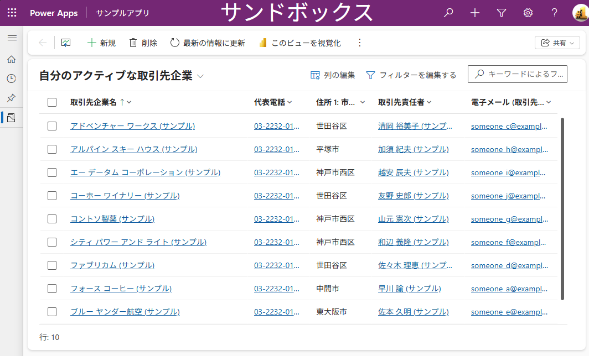

1. 一覧に、エクスポートしたいデータ (列) だけが表示されているかを確認します。**列の編集** を選択して、足りない列は追加し、不要な列は削除してから、**適用** を選択します。エクスポートされるのは、一覧に表示されている列です。

   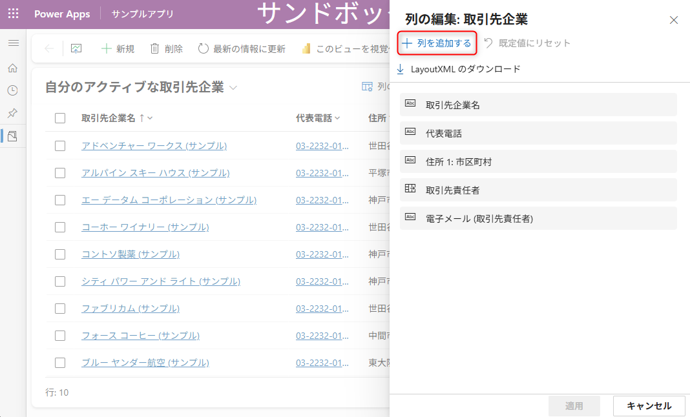

1. コマンド バーの **…** (その他のコマンド) を選択し、**Excel にエクスポート** を選択します。

   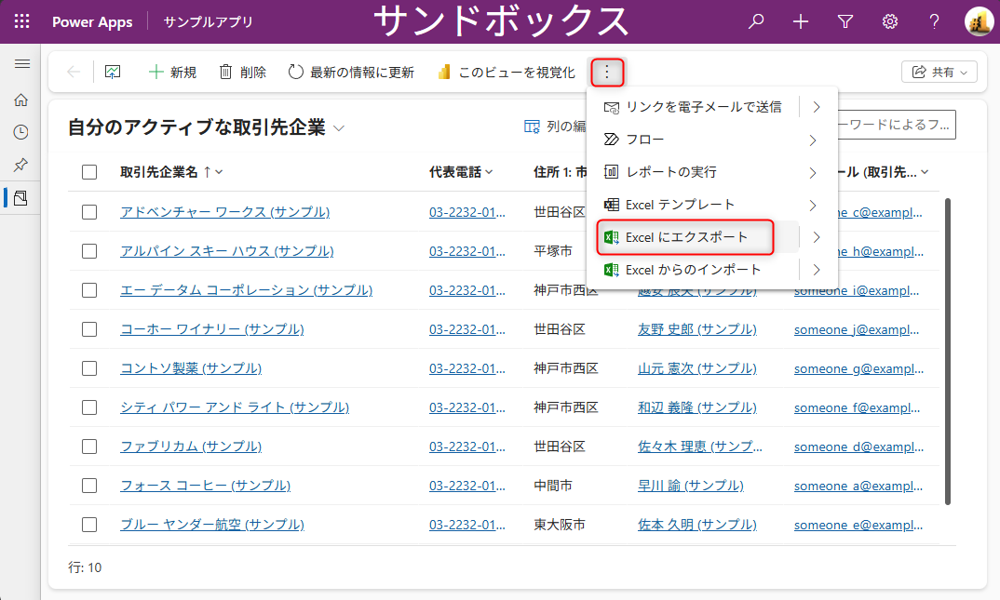

1. ダウンロードが完了したら、保存されたファイルを開きます。

データは、アプリに表示されているものと同じ形式でエクスポートされます。

### エクスポートのオプション

**Excel にエクスポート** のメニューには、用途に応じた次のオプションがあります。単にデータを Excel に出力したい場合は、上記の手順で十分です。

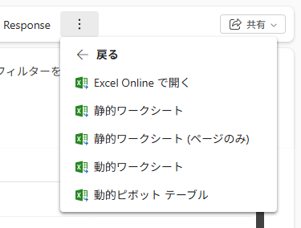

| オプション | 用途 |
| --- | --- |
| Excel Online で開く | データを変更せずに分析する場合や、複数の行をまとめて編集する場合に使います。編集した内容は Dataverse に保存できます。詳細は [Excel Online でデータを編集して保存する](#anchor-excel-online) をご確認ください。 |
| 静的ワークシート | 現在のビューのすべてのページを、スナップショットとしてエクスポートします。アプリにアクセスできないユーザーにデータを共有する場合にも使えます。 |
| 静的ワークシート (ページのみ) | 現在のページに表示されているデータだけをエクスポートします。 |
| 動的ワークシート | Excel の更新機能を使って、Dataverse から最新のデータを取得できるワークシートをエクスポートします。 |
| 動的ピボット テーブル | ピボット テーブルでデータを確認する場合に使います。 |

### エクスポート時の制限事項と注意点

- 静的ワークシートと動的ワークシートは、一度に最大 100,000 行までエクスポートできます。
- エクスポートがタイムアウトする場合は、次の方法をお試しください。
  - フィルター条件を調整して、エクスポートする行数を減らす。
  - ルックアップ列を減らす。
  - 列の数を減らす。
- 仮想テーブルは、Excel へのエクスポートをサポートしていません。

## データをインポートする

### インポートするファイルを準備する

インポートするファイルは、エクスポートした Excel ファイル (.xlsx) にデータを追加して作成できます。

1. [Excel にエクスポートする](#anchor-export-steps) の手順で、インポート先のテーブルを Excel にエクスポートします。
1. エクスポートしたファイルを開き、インポートするデータを入力します。既存の行の値を編集してインポートすると、該当する行が更新されます。

   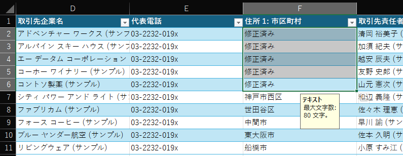

1. ファイルを保存します。

> [!IMPORTANT]
> 列の追加・変更はしないでください。追加・変更した列はテーブルにマップされないため、インポートが失敗します。計算列、ロールアップ列、保護された列は、Excel 上では編集できますが、Dataverse にインポートして戻すことはできません。

アプリからダウンロードできる Excel テンプレート (**Excel テンプレート** > **テンプレートのダウンロード**) を使う方法もあります。

### ファイルをインポートする

1. モデル駆動型アプリで、インポート先のテーブルを開きます。
1. コマンド バーの **…** (その他のコマンド) を選択し、インポートするファイルの種類に合わせて、次のいずれかを選択します。
   - **Excel からのインポート**: エクスポートした Excel ファイルなど、.xlsx ファイルを使用している場合に選択します。
   - **CSV からのインポート**
   - **XML からのインポート**

   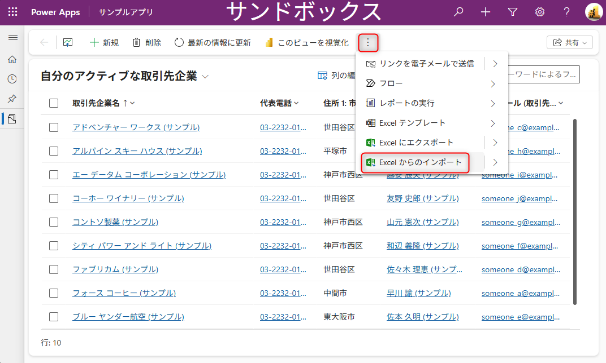

1. **ファイルの選択** で、インポートするファイルを選択します。インポート済みレコードの所有者を確認し、**次へ** を選択します。

   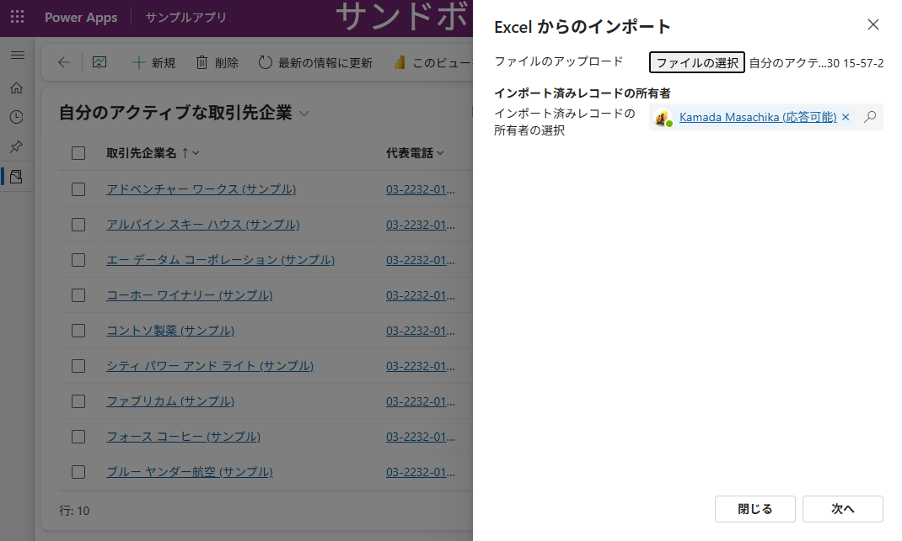

1. **重複の許可** をするかどうかを選択します。

   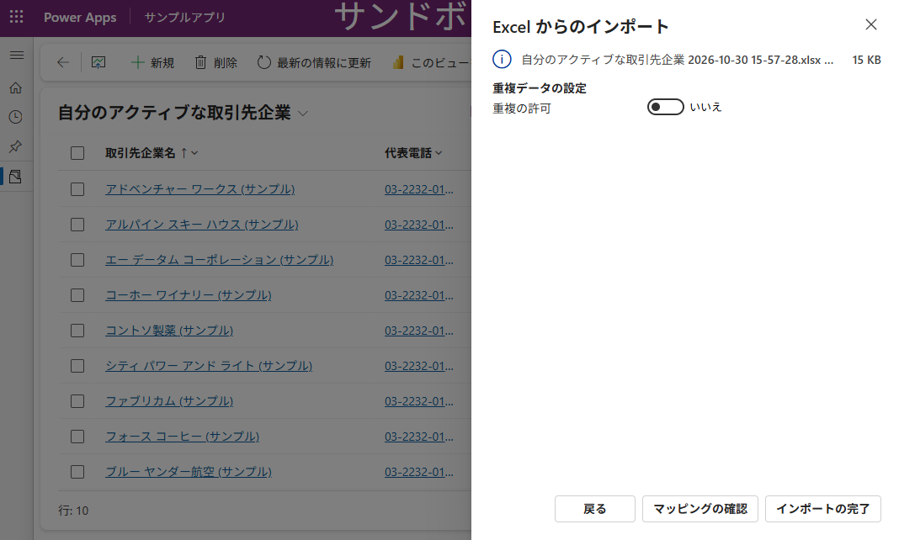

1. CSV と XML の場合は、次の設定を確認します。Excel ファイルの場合、この手順は不要です。
   - CSV の場合: データ区切り文字とフィールド区切り文字を選択します。
   - CSV と XML の場合: 代替キーを定義している場合は、**代替キー** のドロップダウン リストから選択します。代替キーは、インポート時に行を一意に識別して更新するために使用されます。
1. **マッピングの確認** を選択し、列が正しくマップされていることを確認します。問題がなければ、**インポートの完了** を選択します。
1. **進行状況の追跡** を選択して、インポートの進行状況を確認します。ステータスが「完了」になり、成功した件数が表示されれば、インポートは完了です。

   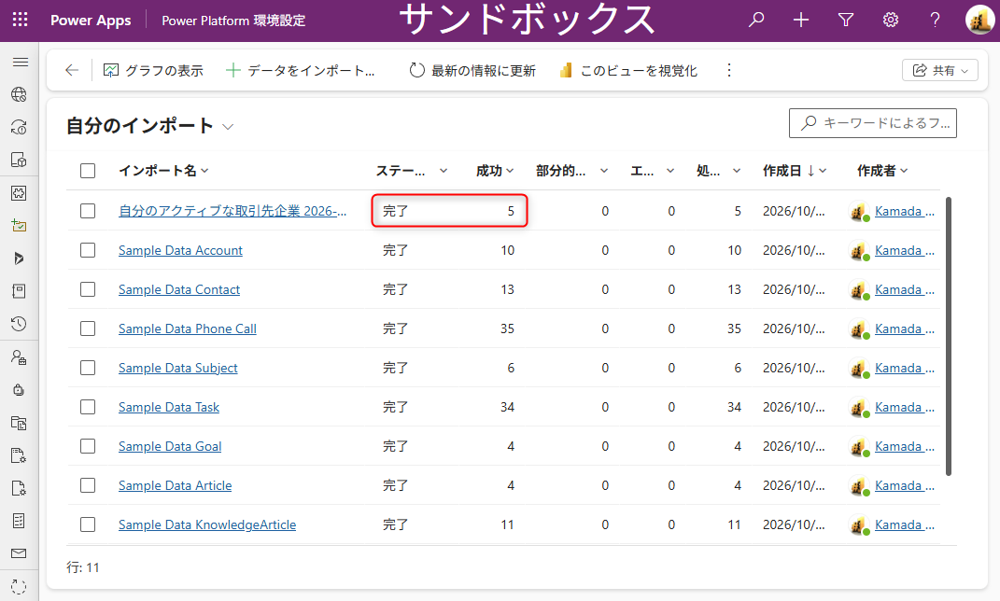

インポートが完了すると、テーブルの一覧にデータが反映されます。

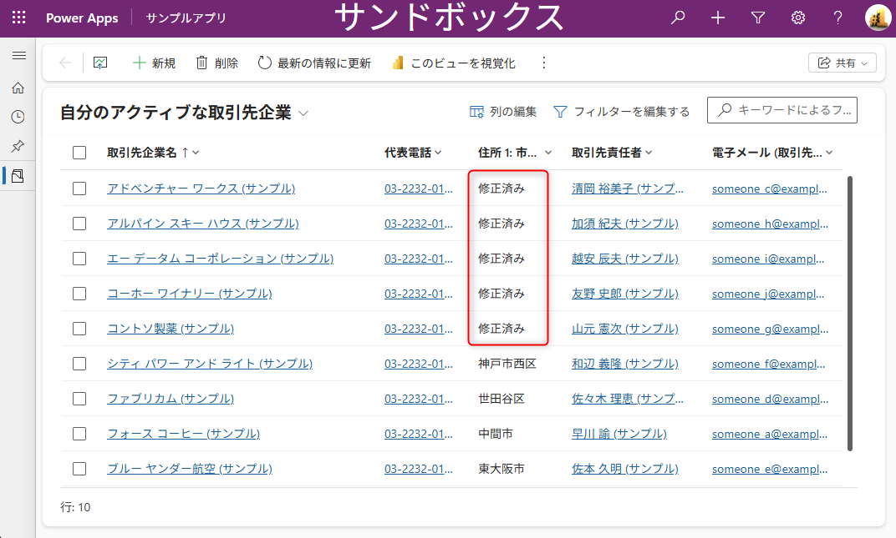

### マッピングを確認する

インポート時には、ファイルの列見出しがテーブルの列の表示名と一致しているかを確認します。一致する列は自動でマッピングされます。一致しない列は、手動でマッピングする必要があります。

- **プライマリ フィールド**: インポートに必須の列です。マップ済みの列には、緑色のチェック マークが表示されます。
- **オプション フィールド**: 任意の列です。列見出しが表示名と一致する場合は、自動で選択されます。
- **一致しない列**: 赤い感嘆符が表示されます。マップ先の列を選択してください。
- **無視**: オプション フィールドでのみ選択できます。無視した列のデータはインポートされません。

ファイルの列に固定された値のセット (「はい」と「いいえ」、「低」と「高」など) が含まれる場合は、その列を **オプション セット** 型の列にマップします。オプション セット列の横のボタンを選択し、値を選択して、**OK** を選択してください。

### インポート時の制限事項と注意点

- インポートできるファイルの最大サイズは、.zip ファイルが 32 MB、その他の形式が 8 MB です。
- 一度にインポートできるファイルは 1 つです。複数のファイルをインポートする場合は、ウィザードをもう一度実行します。

## Excel Online でデータを編集して保存する

**Excel にエクスポート** のメニューにある **Excel Online で開く** は、エクスポートだけでなく、編集した内容を Dataverse に戻すインポートの用途でも使えます。既存の行の編集に加えて、新しい行の追加もできます。Excel Online でデータを編集して **保存** を選択すると、変更内容がインポート用に送信されます。ファイルをダウンロードしたり、インポート ウィザードを操作したりする必要がなく、簡単に編集できます。

1. モデル駆動型アプリで、編集するテーブルと該当するビューを開きます。
1. コマンド バーの **…** (その他のコマンド) を選択し、**Excel にエクスポート** > **Excel Online で開く** を選択します。

   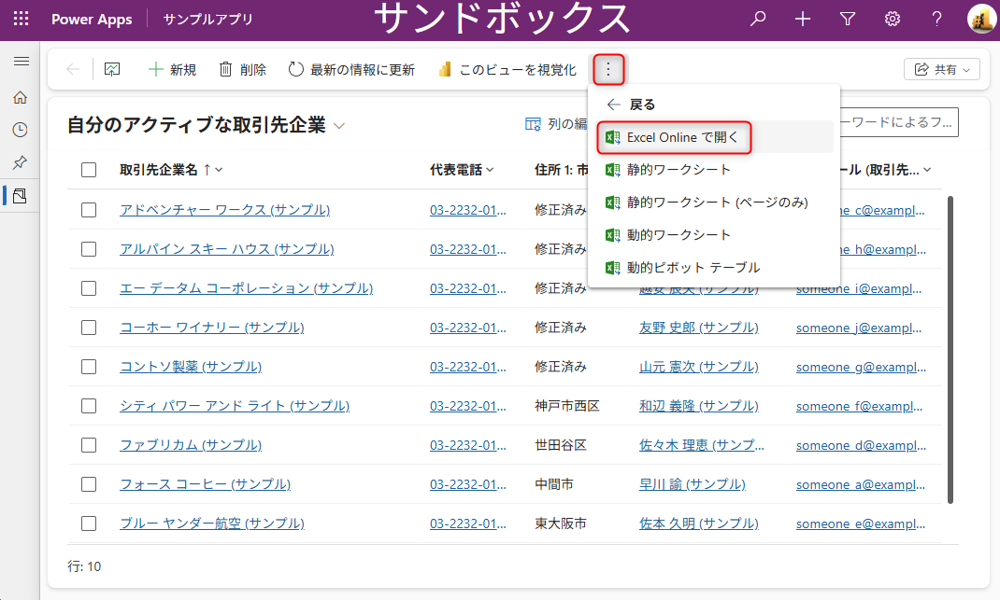

1. Excel Online で、データを編集します。編集が完了したら、**保存** を選択します。

   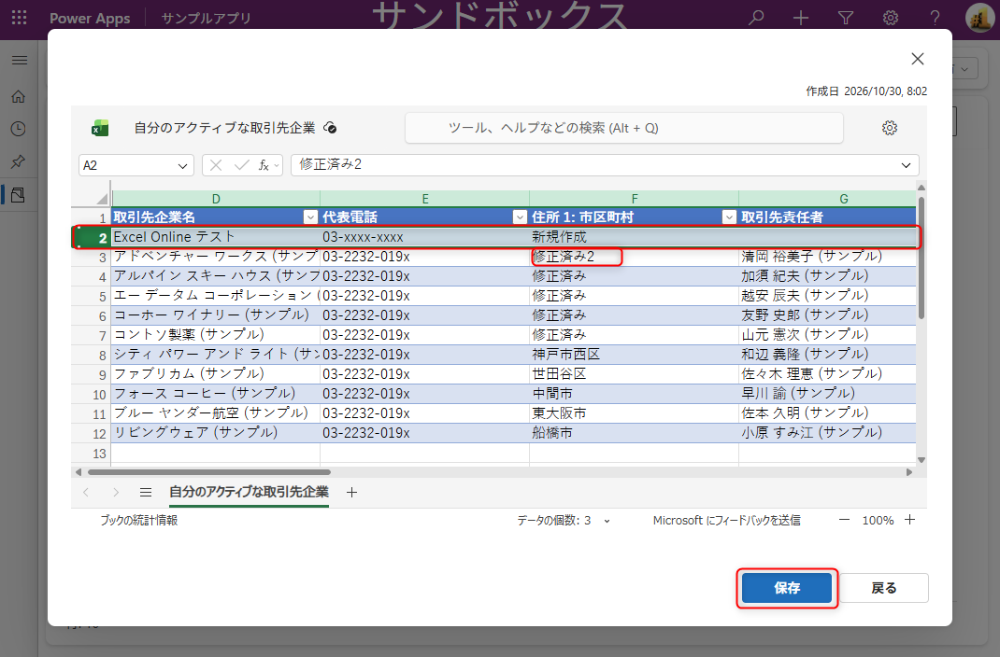

1. 「インポート用にデータが送信されました」と表示されたら、**進行状況の追跡** を選択して、インポートの進行状況を確認します。

   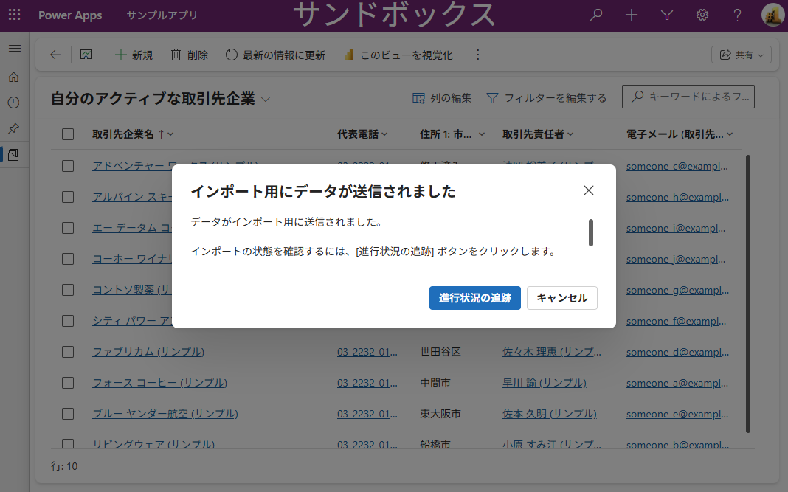

インポートが完了すると、編集した内容がテーブルの一覧に反映されます。

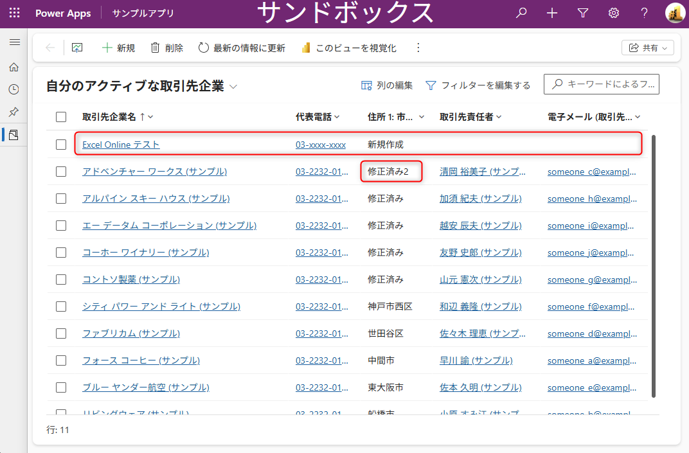

次の点にご注意ください。

- Excel Online で追加したグラフ、計算、列、色などは、Dataverse には保存されません。ファイルの保存時の問題を避けるため、Excel のセルの既存の書式は保持してください。多数の変更を行うと、インポートが失敗する場合があります。
- **Excel Online で開く** は、すべてのテーブルで使えるわけではありません。オプションが表示されない場合は、そのテーブルでは使用できません。

## まとめ

モデル駆動型アプリのコマンド バーを使うと、Dataverse テーブルのデータを、Excel や CSV でエクスポート・インポートできます。

- データの出力は、コマンド バーの **Excel にエクスポート** を選択するだけで行えます。用途に応じて、メニューのオプションも使えます。
- データの取り込みは、エクスポートした Excel ファイルにデータを追加し、列を変更せずにインポートします。
- 少量のデータを編集して反映したい場合は、**Excel Online で開く** を使うと、ファイルのダウンロードやインポート ウィザードの操作なしで、編集内容を Dataverse に保存できます。

## 参考情報

- [Excel にデータをエクスポートする](https://learn.microsoft.com/ja-jp/power-apps/user/export-data-excel)
- [グリッド ページで個人用ビューを作成および管理する](https://learn.microsoft.com/ja-jp/power-apps/user/grid-filters-advanced)
- [Excel の静的ワークシートへのエクスポート](https://learn.microsoft.com/ja-jp/power-apps/user/export-excel-static-worksheet)
- [Excel の動的ワークシートにデータをエクスポートする](https://learn.microsoft.com/ja-jp/power-apps/user/export-excel-dynamic-worksheet)
- [データのインポート方法](https://learn.microsoft.com/ja-jp/power-apps/user/import-data)
- [Excel Online で自分のアプリ データを開く](https://learn.microsoft.com/ja-jp/power-apps/user/export-to-excel-online)

