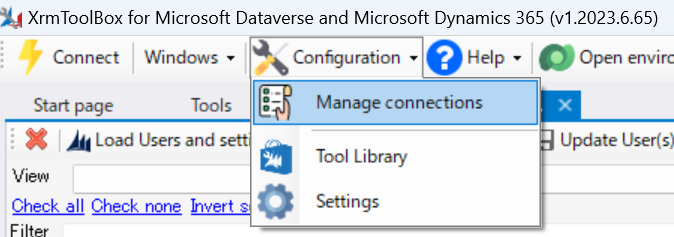
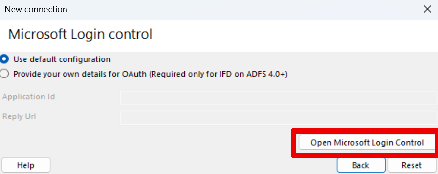
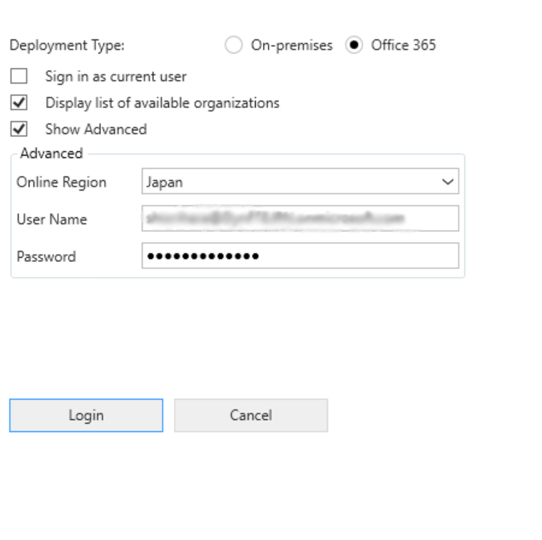
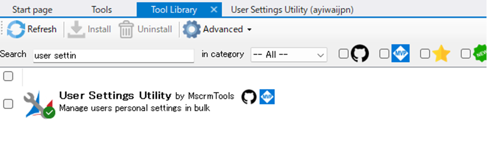
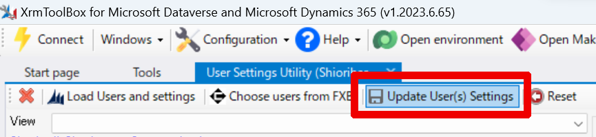

こんにちは、Power Platform サポートの原です。

今回は、ユーザーの個人設定を管理者が変更する方法をご紹介します。

<!-- more -->

## はじめに
個人設定では、タイムゾーンを変更したり、レコードのリストの各ページに表示するレコード数を変更したり、言語や通貨を変更したりするなど、さまざまな設定ができます。<br>
一方で、ユーザーの個人設定は通常、ユーザー個人でのみ変更できる項目であり、管理者が一括で変更する標準機能は提供されていません。<br>
ただし、代替案として以下に紹介する方法で、管理者が他ユーザーの個人設定を変更できます。
また、これはあくまでユーザーの個人設定を管理者が変更する方法であり、既定値を変更するものではないことにご注意ください。<br>

なお、弊社検証環境では下記にご紹介する API にて、ユーザーの個人設定の一括変更が実行可能なことを確認しておりますが、<br>下記でご案内する XrmToolBox については、サードパーティー製ツールですので、<br>本ツールをご利用いただく中でのエラーやご不明点については弊社からサポートを提供できません。<br>
詳細な使用方法やエラーに対する対処は製品提供元にご確認いただく必要があります。あらかじめご了承ください。

## XrmToolBox を使用して変更する
1. XrmToolBox を [モデル駆動型アプリの開発者ツール](https://learn.microsoft.com/ja-jp/power-apps/developer/model-driven-apps/developer-tools) の記事の案内に従ってダウンロードします。

2. XrmToolBox アプリケーションを開き、「Configuration」タブより「Manage connections」を選択します。

3. 「New Connection」を選択し、「Microsoft Login Control」を選択します。
4. 「Open Microsoft Login Control」を選択し、ユーザー名などを入力します。
<br>

5. 該当環境を選択して Connection の任意の名前を入力し、「Finish」を選択します。
Connection が作成されたことを確認し、「Connections Manager」ウィンドウを閉じます。
6. 「Tools」タブより「User Settings Utility」を選択し、ダブルクリックします。
(表示されない場合は事前に「ToolLibrary」よりツールを追加してください)
※「Do you want to connect to an organization first?」というダイアログが表示された場合は「はい」を選択し、
作成した Connection 先を選び「Connect」を選択してください。

7. 「Load Users and settings」を選択します。
8. 対象ユーザーを選択し、変更したい個人設定を変更します。
9. 「Update User Settings」を選択します。<br>


以上の手順で管理者がユーザーの個人設定を変更できます。
また、繰り返しにはなりますが、冒頭でお伝えしたとおり、XrmToolBox についてはサードパーティー製ツールですので、本ツールをご利用いただく中でのエラーやご不明点については弊社からサポートを提供できません。あらかじめご了承ください。

## API を使用して変更する
以下の方法で個人設定を変更できます。
また、以下では一例としてタイムゾーンを変更する方法をご紹介します。

* 要求の方法：PATCH
* 要求の URL：`https://<orgname>.crm7.dynamics.com/api/data/v9.2/usersettingscollection(<UserID>)`
* ヘッダー：以下を入力します。

  ```json
  {
    "Accept": "application/json",
    "Content-Type": "application/json; charset=utf-8",
    "OData-MaxVersion": "4.0",
    "OData-Version": "4.0"
  }
  ```
* 要求の本文：以下を入力します。<br>※ここではタイムゾーンを「(GMT+09:00) 大阪、札幌、東京」に変更する方法をご紹介しています。本文を変更することで、タイムゾーン以外の個人設定を変更できます。

  ```json
  {
    "timezonecode": 235
  }
  ```

## おわりに
本記事が、ユーザーの個人設定を管理いただく上でのお役に立てましたら幸いです。
ご不明な点などがありましたら、弊社サポート一同お待ちしておりますので、ぜひお気軽にお問い合わせください。
