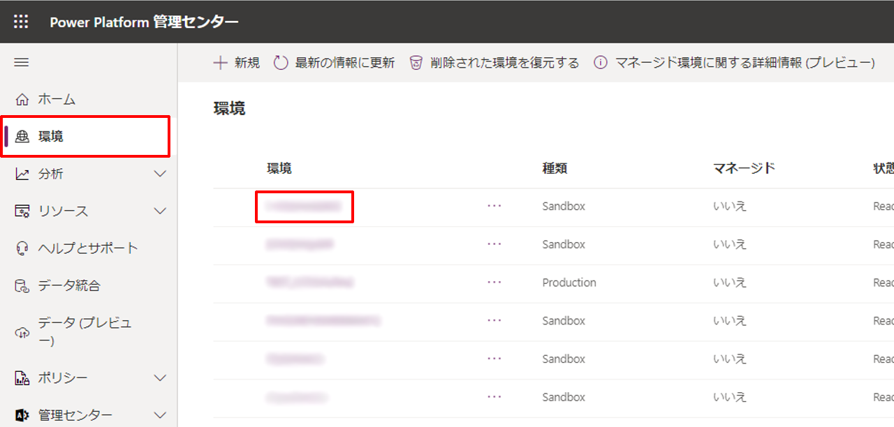
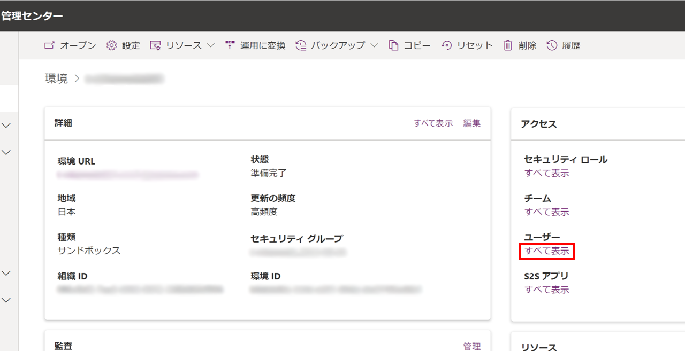
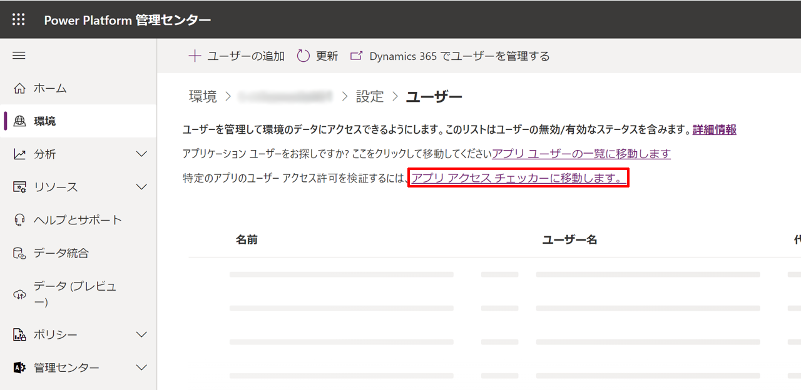
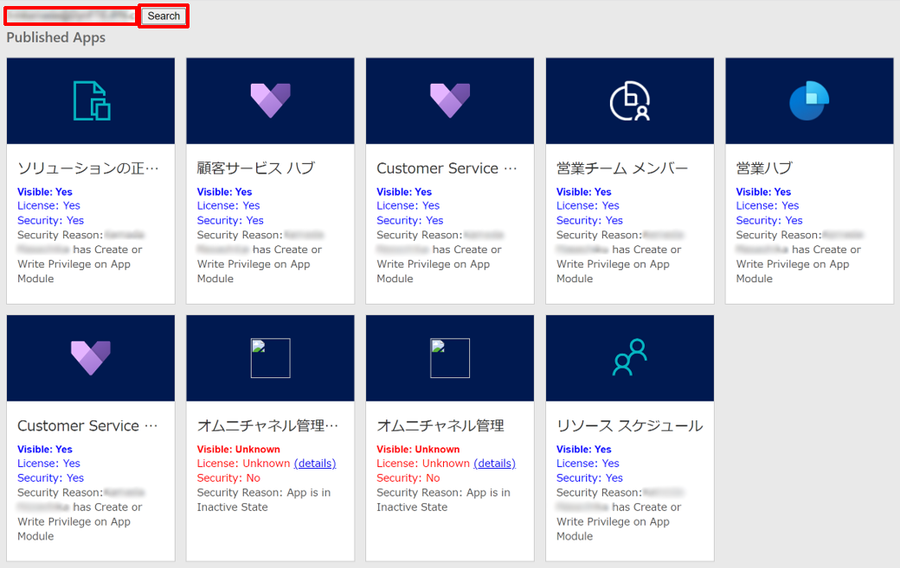
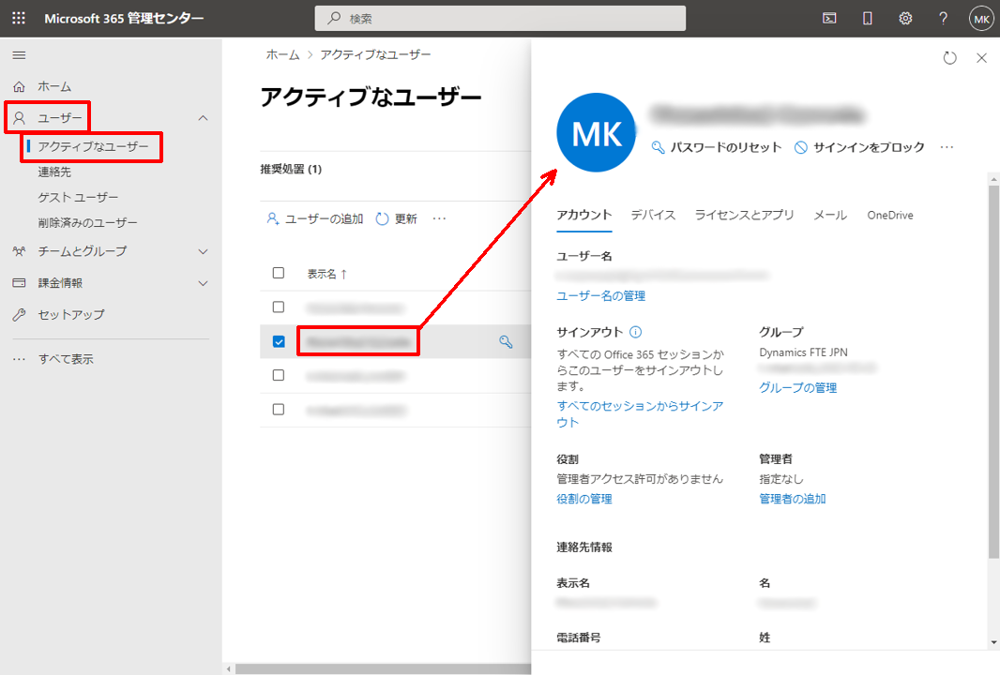
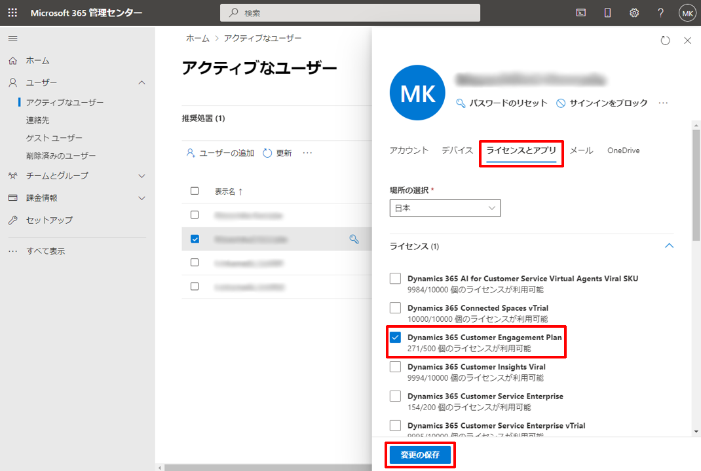
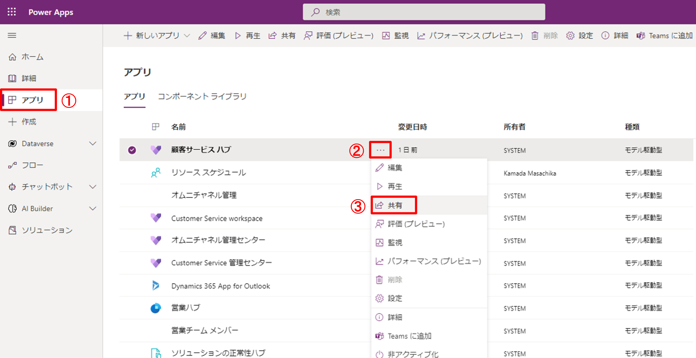
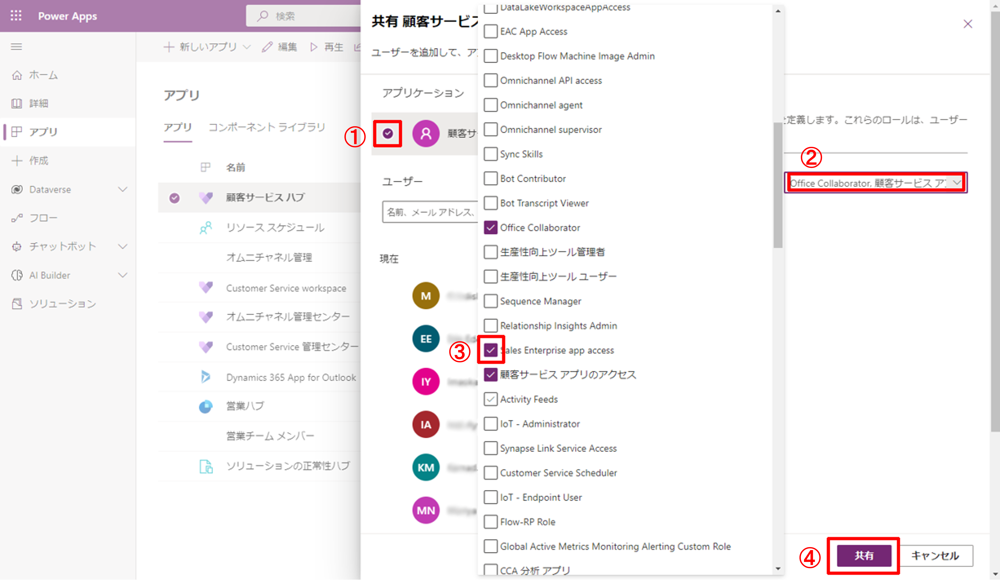
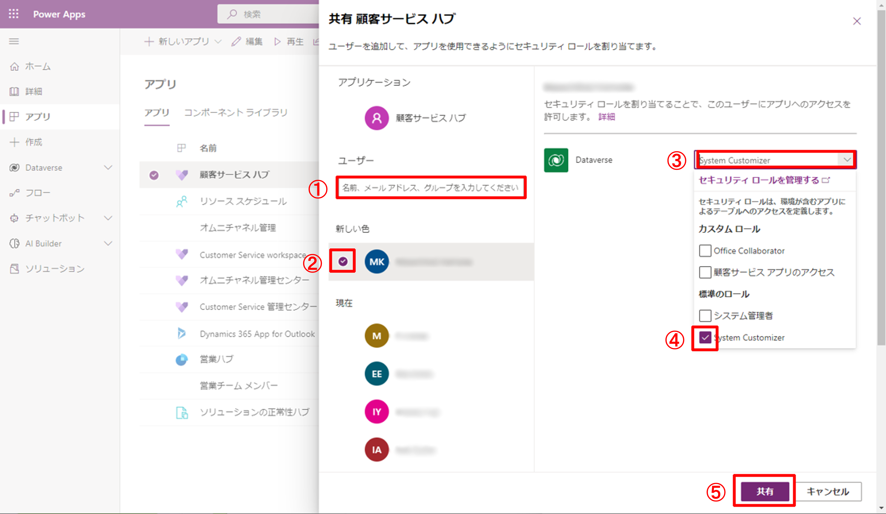

こんにちは、Power Platform サポートチームの鎌田です。

本記事では、モデル駆動型アプリにアクセスできないときの対処法についてご案内します。

<!-- more -->

## 目次

- [App Access Checker を使ってユーザーがアプリにアクセスできるか確認する](#anchor-app-access-checker)
- [ライセンスの割り当て](#anchor-license)
- [セキュリティ ロールの割り当て](#anchor-security-role)
- [補足](#anchor-supplement)
- [注釈](#anchor-notes)
- [参考情報](#anchor-references)

## App Access Checker を使ってユーザーがアプリにアクセスできるか確認する

モデル駆動型アプリにユーザーがアクセスするためには、以下の 2 点が必要です。

- ユーザーにアプリを使用するための**ライセンス**が割り当てられていること
- ユーザーにアプリを使用できる**セキュリティ ロール** [(※1)](#anchor-notes) が割り当てられていること

**App Access Checker** を使用すると、ユーザーがアプリを使用するためのライセンスとセキュリティの条件を満たしているかを確認できます。
以下の手順では、App Access Checker を使って、ユーザーのアプリ使用に関するライセンスとセキュリティを確認する方法についてご説明します。

1. グローバル管理者の権限を持つユーザー アカウントで、[Power Platform 管理センター](https://admin.powerplatform.microsoft.com/) にサインインします。

2. 左ペインより [環境] を選択し、ユーザーがアプリにアクセスできない事象が発生している環境を選択します。

3. 環境の詳細ページが開いたら、画面右の [アクセス] タブ内から [ユーザー] の下の [すべて表示] を選択します。

4. 設定ページに遷移したら、[アプリ アクセス チェッカーに移動します。] のリンクを選択します。

5. App Access Checker のページに遷移したら、左上のテキスト ボックスに、アプリにアクセスできないアカウントのユーザー ID またはメール アドレスを入力し、[Search] ボタンを選択すると、ユーザー アカウントのアプリ使用に関する情報を確認できます。
このとき、License および Security が Yes と表示されていれば、Visible も Yes となり、当該ユーザー アカウントで環境内のアプリを使用できることを意味します。
License または Security で No と表示されている場合は、次の [ライセンスの割り当て](#anchor-license) または [セキュリティ ロールの割り当て](#anchor-security-role) をお試しください。

## ライセンスの割り当て

App Access Checker にて、アカウントの License が No と表示されている場合、適切なライセンス [(※2)](#anchor-notes) の割り当てが必要です。
以下の手順でライセンスを割り当てます。

1. ライセンス割り当ての権限を持つ管理者アカウントを使用して、[Microsoft 365 管理センター](https://admin.microsoft.com/) にアクセスします。

2. 左ペインより、[ユーザー] > [アクティブなユーザー] に移動し、ライセンスを割り当てるユーザーを選択します。そのユーザーの設定がポップアップで開きます。

3. ポップアップの [ライセンスとアプリ] タブを選択し、ユーザーに割り当てたいライセンスにチェックをつけ、[変更の保存] を選択すると、ユーザーへのライセンスの割り当てが完了します。

> [!NOTE]
> Dataverse は、ユーザーに割り当てられたサービス プランをキャッシュします。そのため、Microsoft Entra のライセンスの割り当てが、すぐには Dataverse に反映されない場合があります。反映されない場合は、ユーザーにいったんサインアウトして、再度サインインしてもらってください。それでも解決しない場合は、30 分ほど待ってから、再度サインアウトとサインインをお試しください。

## セキュリティ ロールの割り当て

App Access Checker にて、アカウントの Security が No と表示されている場合、適切なセキュリティ ロールの割り当てが必要です。
以下の手順でセキュリティ ロールを割り当てます。

1. 管理者権限を持ったユーザー アカウントで、[Power Apps](https://make.powerapps.com/?utm_source=padocs&utm_medium=linkinadoc&utm_campaign=referralsfromdoc) にサインインします。

2. 左ペインから [アプリ] を選択後、ユーザーにアクセスを許可したいアプリの […] を選択して表示されるポップアップの [共有] を選択します。

3. この操作により、指定したセキュリティ ロールが割り当てられたユーザー アカウントに対して、一括でこのアプリへのアクセスを許可できます。
   - アプリ名の左にチェックをつけ、下図②のテキスト ボックスを選択すると、中央にカスタム ロールを管理するポップアップが表示されます。
   - アプリへのアクセスを許可するセキュリティ ロールにチェックをつけ、[共有] ボタンを選択して変更を保存します。

4. 手順 3 では、特定のセキュリティ ロールを持つユーザー アカウントをまとめてアクセスできるように指定する方法を紹介しました。ここでは、個別のユーザーごとにアクセスを許可する方法を紹介します。
   - [ユーザー] の下のテキスト ボックスからアクセスを許可したいアカウントを検索し、下図②のようにチェックを入れます。
   - 下図③を選択すると、アプリへのアクセスが許可されているセキュリティ ロールが表示されます。アクセスを許可したいアカウントに割り当てたいセキュリティ ロールにチェックをつけ、[共有] ボタンを選択して変更を保存します。

## 補足

- App Access Checker は、次の URL を直接開いても利用できます。
  - 形式: `<環境 URL>/WebResources/msdyn_AppAccessChecker.html`
  - 例: `https://contoso.crm7.dynamics.com/WebResources/msdyn_AppAccessChecker.html`
  - `contoso` の部分は、お使いの環境に合わせて置き換えてください。

## 注釈

- (※1) セキュリティ ロールとは、営業担当者などの異なるユーザーが異なる種類のレコードにどのようにアクセスできるかを定義する機能のことです。詳しくは、[セキュリティ ロールおよび特権](https://learn.microsoft.com/ja-jp/power-platform/admin/security-roles-privileges#security-roles) をご覧ください。
- (※2) アプリへのアクセスに必要なライセンスについては以下をご覧ください。
  - [価格 | Microsoft Dynamics 365](https://dynamics.microsoft.com/ja-jp/pricing/)
  - [価格 - Power Apps](https://powerapps.microsoft.com/ja-jp/pricing/)
  - [Licensing Guide のダウンロード リンク](https://go.microsoft.com/fwlink/p/?LinkId=866544)

## 参考情報

| リンク | 内容 |
| ---- | --- |
| [モデル駆動型アプリのアクセス チェッカー](https://learn.microsoft.com/ja-jp/power-apps/maker/model-driven-apps/app-access-checker) | App Access Checker の使い方と、結果 (Visible、License、Security) の見方、ライセンスが反映されない場合の注意について解説しています。 |
| [How to access "App Access Checker" to see Role & Privileges needed for AppModule Entity to see and launch model app](https://community.dynamics.com/crm/f/microsoft-dynamics-crm-forum/427100/how-to-access-app-access-checker-to-see-role-privileges-needed-for-appmodule-entity-to-see-and-launch-model-app) | 本記事で紹介した App Access Checker のアクセスについて解説している英語記事です。 |
| [ユーザー アカウント、ユーザー ライセンス、セキュリティ ロールを管理する](https://learn.microsoft.com/ja-jp/dynamics365/marketing/admin-users-licenses-roles) | Dynamics 365 のモデル駆動型アプリに必要な、ライセンスとセキュリティ ロールの割り当てについて解説しています。 |
| [モデル駆動型アプリのよく寄せられる質問](https://learn.microsoft.com/ja-jp/power-apps/maker/model-driven-apps/model-app-faq) | 解説している内容としてはタイトルの通りですが、環境内のアプリがユーザーに表示されない原因について触れています。 |
| [セキュリティ ロールおよび特権](https://learn.microsoft.com/ja-jp/power-platform/admin/security-roles-privileges) | 本記事でアプリのアクセスを許可するために使用したセキュリティ ロールについて解説しています。 |
