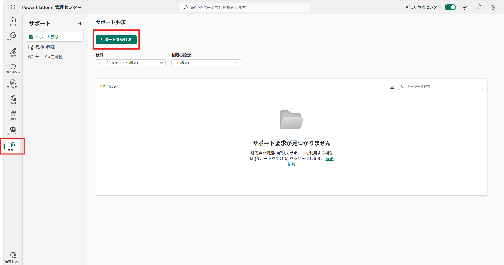

こんにちは、Power Platform サポート チームの三田です。

本記事では、Power Platform 管理センター (PPAC) からサポート リクエストを起票するために必要な権限についてご紹介します。

<!-- more -->

## この記事でわかること
- PPAC でサポート リクエストを起票できるロール
- PPAC からサポート リクエストを起票する方法

## 目次
- [PPAC からサポート リクエストを起票できるロール](#anchor-roles)
- [PPAC からサポート リクエストを起票する方法](#anchor-steps)
- [まとめ](#anchor-summary)
- [注意事項（情報の更新可能性）](#anchor-notice)

## PPAC からサポート リクエストを起票できるロール

Power Platform 管理センター (PPAC) では、サポート リクエストを作成するために、以下のサポート作成が有効化されたロールのいずれかを保持している必要があります。

＜Microsoft Entra ロール＞
> - Microsoft Entra ロール管理者
> - 会社管理者 (グローバル管理者)
> - 課金管理者
> - サービス管理者
> - セキュリティ管理者
> - コンプライアンス管理者
> - ヘルプデスク管理者
> - パートナー代理管理者
> - SharePoint 管理者
> - Teams 管理者
> - Exchange 管理者
> - Fabric 管理者 (旧 Power BI 管理者)
> - Power Platform 管理者
> - CRM サービス管理者
> - Power Apps Full 管理者

＜セキュリティ ロール＞
> - 環境管理者 (または Dataverse のシステム管理者ロール)
> - CRM 組織の管理者 (Dataverse のシステム管理者ロール)
> - Power Apps 環境管理者
> - LCS ユーザー

また、技術的サポートを受けるためには、ご契約のサポート プラン (Subscription / ProDirect / Unified など) が要件を満たしている必要がありますので、ご留意ください。

＜参考資料＞
- [サポートを受ける](https://learn.microsoft.com/ja-jp/power-platform/admin/get-help-support)
- [サポートの概要](https://learn.microsoft.com/ja-jp/power-platform/admin/support-overview#using-support)

## PPAC からサポート リクエストを起票する方法

事前に、[上記の起票に使用するアカウントの権限](#anchor-roles)と、ご契約のサポート プランの要件をご確認ください。最小権限での実施を推奨します。

1. [Power Platform 管理センター](https://admin.powerplatform.microsoft.com/) にアクセスし、対象テナントのアカウントでサインインします。

2. 左側のナビゲーションから「サポート」を選択し、「サポートを受ける」ボタンを選択します。

3. 項目に従って、以下の情報を入力します。
   - 製品/サービス: 例: Power Apps / Power Automate / Power Pages / Dataverse など
   - 環境: 影響している環境 (開発/本番など)
   - 問題の種類/カテゴリ: 最も近い項目を選択
   - 重大度 (影響度): 影響範囲・業務影響に応じて選択

起票の際に「どんな動作を期待するか」など、詳細な情報をご記入いただけると、より的確で迅速なご案内ができます。ご協力をお願いします。

【補足】
手順 2 の後に、ほとんどのユーザーにはサポート エージェント (AI を利用した仮想エージェント) が表示されます。サポート エージェントとチャットすることで、早期解決につなげられます。サポート エージェントが利用できない場合は、バックアップのサポート エクスペリエンス (Web フォーム) が表示されます。

＜参考資料＞
- [Power Platform 管理センターでサポートを受ける - サポート エージェントを使用する](https://learn.microsoft.com/ja-jp/power-platform/admin/get-help-support#use-the-support-agent)

## まとめ

本記事では、Power Platform 管理センター (PPAC) でサポート リクエスト (SR) を起票するために必要な権限についてご紹介しました。Power Platform について少しでもお困りごとがありましたら、サポート チームが全力でご支援します。ぜひ本記事を参考に、気兼ねなく SR を起票してください。

## 注意事項（情報の更新可能性）
本記事の内容は執筆日時点の情報に基づいております。製品の仕様や UI、ロールの名称・権限、制限事項、およびリンク先の内容は将来的に変更される可能性がございます。最新情報は公式ドキュメントをご確認くださいますようお願い申し上げます。
